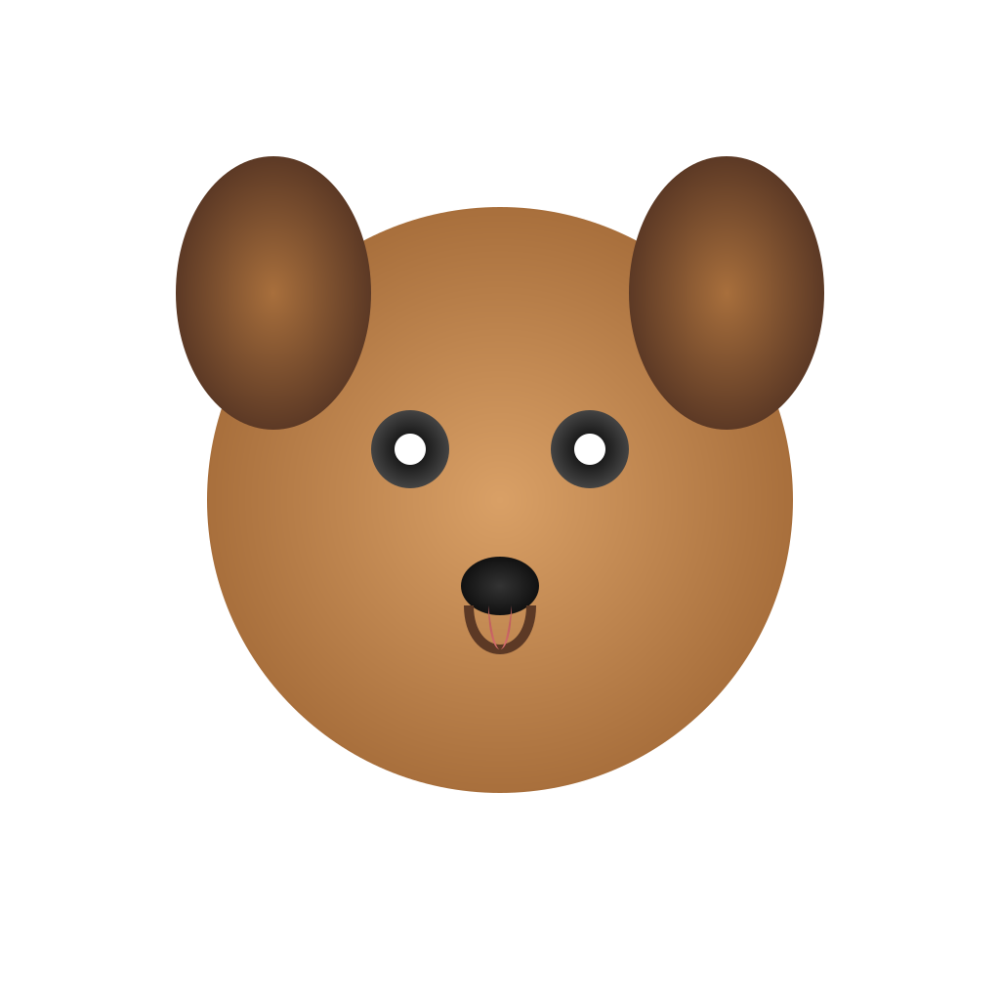

# 🤖 Azure GPT-4o Vision Chat & SVG Art Studio

> An image-understanding chatbot and a text-to-image generator, both powered by a **single GPT-4o deployment on Microsoft Azure AI Foundry**. Images are generated **without any image-generation model** (no DALL·E, no Stable Diffusion). GPT-4o draws them by writing SVG code.


<p align="center">
  
  <br/>
  <em>This image was drawn by GPT-4o as SVG code. No image-generation model was used.</em>
</p>

---

## ✨ Overview

This project shows how much a single multimodal LLM deployment can do. It has two Streamlit apps:

| App | File | What it does |
|---|---|---|
| 🖼️ **Image Explainer Chatbot** | `apps/image_chatbot.py` | Upload an image and chat about it. GPT-4o describes and analyzes the image, answers questions, and remembers the conversation. |
| 🎨 **SVG Art Studio** | `apps/svg_image_maker.py` | Describe a picture in plain English. GPT-4o writes it as **SVG vector code**, renders it, lets you refine it with follow-up prompts, and exports it as SVG or PNG. |

## 💡 How the image generation works

Most AI image apps call a dedicated image model. This one doesn't. Instead:

```
Your prompt ──► GPT-4o (text model) ──► SVG code ──► rendered in browser ──► SVG / PNG download
```

1. A system prompt tells GPT-4o to act as an illustrator that answers **only with SVG code** (shapes, paths, gradients).
2. The app extracts the `<svg>…</svg>` block from the response and **rejects any scripts or event handlers** for safety.
3. The SVG is shown in the app and can be downloaded, or converted to PNG with `cairosvg`.
4. Follow-up prompts send the **current SVG back to the model**, so you can make changes like "make the sky purple" or "add a moon".

**Why this approach:**
- 💰 **Cheaper.** It reuses the chat deployment you already have, so you don't need a separate image model.
- 📐 **Vector output.** The images scale to any size without getting blurry.
- ✏️ **Editable.** The output is code, so you can change it step by step or edit it by hand.

## 🚀 Features

**Image Explainer Chatbot**
- Upload PNG, JPG, JPEG or WEBP images
- Multi-turn conversation memory using the Responses API (`previous_response_id`)
- Also works as a general chatbot when no image is uploaded
- One-click "Clear chat"

**SVG Art Studio**
- Text-to-image through SVG code generation
- Step-by-step editing of the current image
- Basic safety filtering of generated SVG
- Download as **SVG** or **PNG** (1024 px)

## 🛠️ Tech stack

- **Model:** GPT-4o on **Azure AI Foundry**
- **API:** OpenAI Python SDK (`openai>=1.66`) using the **Responses API** with the Azure OpenAI v1 endpoint
- **Frontend:** Streamlit
- **Config:** python-dotenv locally, Azure App Settings in the cloud
- **Rendering:** CairoSVG for SVG → PNG
- **Hosting:** Microsoft Azure

## 📁 Project structure

```
.
├── apps/
│   ├── image_chatbot.py       # Image Explainer Chatbot
│   └── svg_image_maker.py     # SVG Art Studio
├── assets/
│   └── sample-output.png      # Example generated image
├── .env.example               # Template for environment variables
├── .gitignore
├── requirements.txt
└── README.md
```

## ⚙️ Getting started (local)

### Prerequisites
- Python **3.10+**
- An Azure AI Foundry resource with a **GPT-4o** deployment
- *(Optional, for PNG export)* the [Cairo library](https://cairosvg.org/documentation/#installation)

### 1. Clone the repository
```bash
git clone https://github.com/<your-username>/azure-gpt4o-vision-chat-svg-art.git
cd azure-gpt4o-vision-chat-svg-art
```

### 2. Create a virtual environment and install the dependencies
```bash
python -m venv venv
venv\Scripts\activate          # Windows
# source venv/bin/activate     # macOS / Linux
pip install -r requirements.txt
```

### 3. Configure environment variables
Copy `.env.example` to `.env` and fill in your values:

```env
AZURE_OPENAI_BASE_URL=https://<your-resource-name>.services.ai.azure.com/openai/v1/
AZURE_OPENAI_API_KEY=<your-api-key>
CHAT_DEPLOYMENT=<your-gpt-4o-deployment-name>
```

| Variable | Description |
|---|---|
| `AZURE_OPENAI_BASE_URL` | Your Azure AI Foundry OpenAI v1 endpoint |
| `AZURE_OPENAI_API_KEY` | API key for your Azure resource |
| `CHAT_DEPLOYMENT` | The **deployment name** of your GPT-4o model |

### 4. Run
```bash
streamlit run apps/image_chatbot.py
```
```bash
streamlit run apps/svg_image_maker.py
```

## ☁️ Deploying to Azure

1. Create an **Azure App Service** (Linux, Python 3.10+) and deploy this repository to it.
2. Go to **Settings → Environment variables → App settings** and add `AZURE_OPENAI_BASE_URL`, `AZURE_OPENAI_API_KEY` and `CHAT_DEPLOYMENT`.
3. Go to **Configuration → Startup command** and set:
   ```bash
   python -m streamlit run apps/image_chatbot.py --server.port 8000 --server.address 0.0.0.0
   ```
   (Use `apps/svg_image_maker.py` to deploy the SVG Art Studio instead.)

> PNG export needs the Cairo system library, which may not be installed on the Azure host. If it's missing, the app shows a warning and SVG download keeps working.

## 🔒 Security

- `.env` is listed in `.gitignore`, so API keys are **never committed**. In the cloud they are stored as Azure App Settings.
- Generated SVGs are checked for `<script>`, `onload=` and `onclick=` before they are rendered.

## 🗺️ Possible improvements

- Combine both apps into one multi-page Streamlit app
- Save the chat and image history
- Use Microsoft Entra ID (managed identity) authentication instead of API keys

## 📄 License

This project is available under the [MIT License](LICENSE).